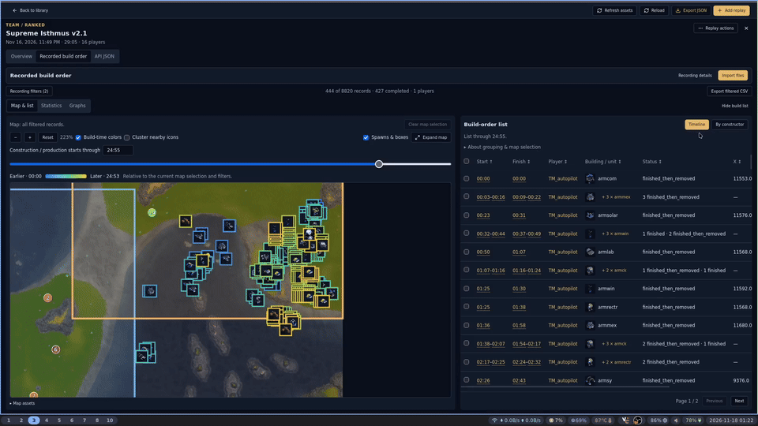
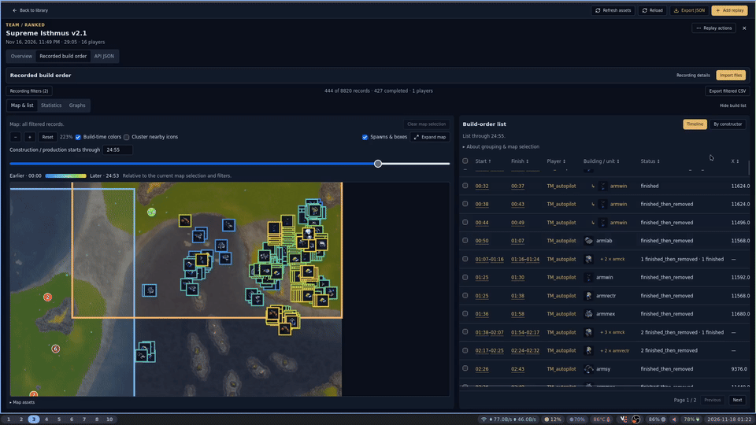
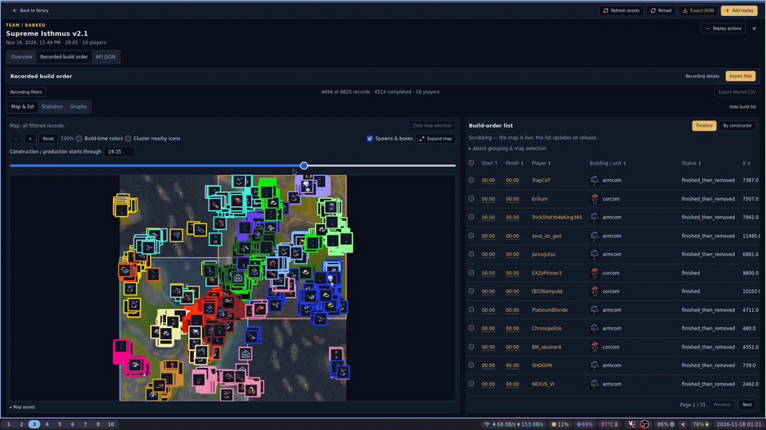
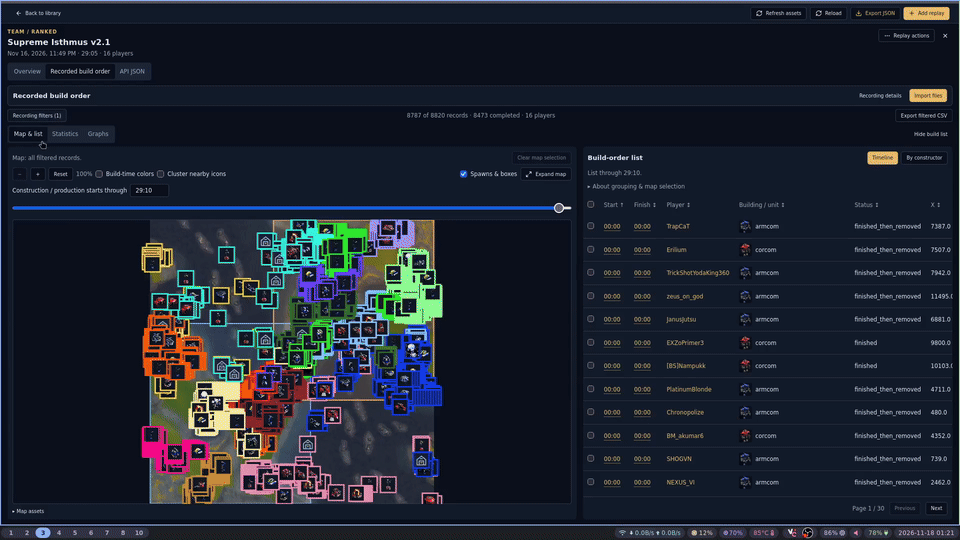
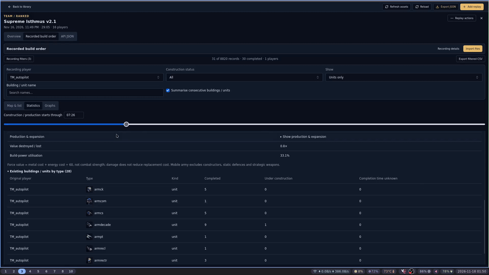
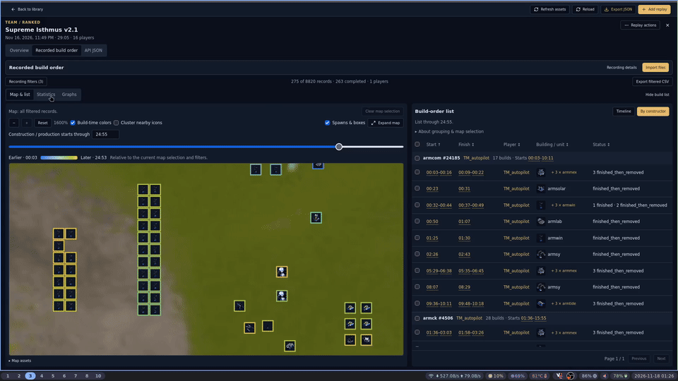
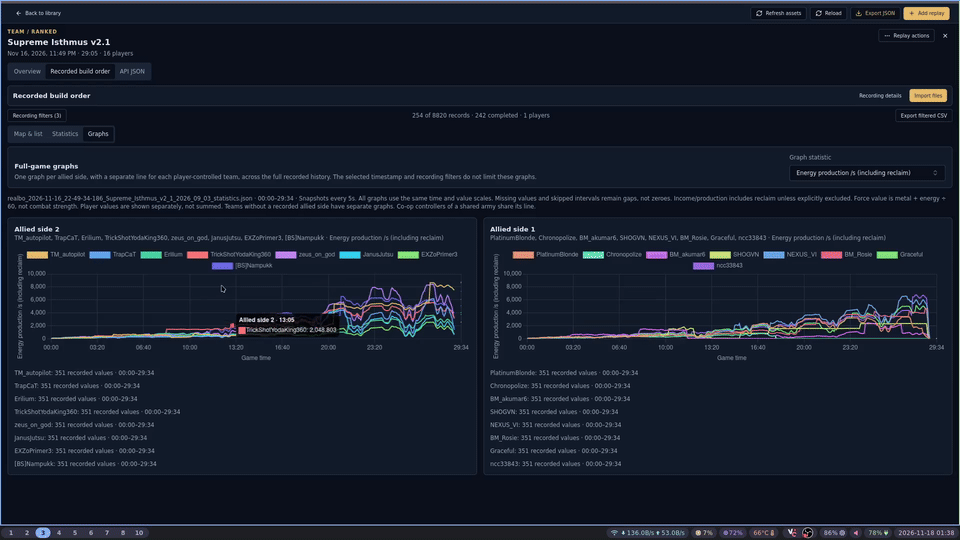

# BAR Build Order Library

A local replay library for Beyond All Reason that helps you study build orders, compare player strategies, and track army and economy development over time.

## Demos

| Timeline | By constructor |
| --- | --- |
|  |  |

| All-player time slider | Player time slider |
| --- | --- |
|  |  |

| Build-time colors | Unit composition |
| --- | --- |
|  |  |

| Statistics | Graphs |
| --- | --- |
|  |  |

## Quick start

All commands below run from the repository root.

1. Install **Node.js 24 LTS (24.15+) or 26+**, **[pnpm 12.21.0](https://pnpm.io/installation)**, and **[uv](https://docs.astral.sh/uv/getting-started/installation/)**. The pnpm version is pinned in `frontend/package.json`; uv can manage Python automatically.
2. Open a terminal in the project directory.
3. Install dependencies and start the backend:

   ```bash
   uv sync --project backend --locked
   pnpm --dir frontend install --frozen-lockfile
   uv run --project backend python backend/server.py
   ```

4. In another terminal at the repository root, start the frontend:

   ```bash
   pnpm --dir frontend dev
   ```

5. Open **http://127.0.0.1:5173** in your browser.
6. Click **Add replay**, paste `https://bar-rts.com/replays/56acec6a4612a888703f0b94af10d0c8`, and optionally add your own remarks or build order.

An internet connection is needed when **adding** a replay and when clicking **Refresh assets** to download map images and building icons. Existing entries and cached assets can be viewed and edited offline. Leave both servers running while using the website; press **Ctrl+C** in each terminal to stop them.

On first startup, Alembic creates an empty `build_orders.sqlite3` database. SQLite is the only library storage; JSON files are not loaded or imported.

### Nix development shell

With Nix flakes enabled, enter the development environment from the project directory:

```bash
nix develop
```

The shell provides uv, Python 3.13, Node.js 24, pnpm, SQLite, and Lua for the widget smoke test. uv uses the Nix-provided Python. Inside this shell, pnpm's automatic version download is disabled to avoid incompatible binaries on NixOS; it uses the Nix-packaged version pinned by `flake.lock` instead of the version in `frontend/package.json`. Dependencies are not installed automatically:

```bash
uv sync --project backend --locked
pnpm --dir frontend install --frozen-lockfile
```

Then use the build and development commands below and the [test commands](docs/README.md#tests) as usual. `flake.lock` pins the Nix packages; run `nix flake update` to update them.

### Development and build preview

Run the backend and Vite in separate terminals:

```bash
uv run --project backend python backend/server.py
```

```bash
pnpm --dir frontend dev
```

Open **http://127.0.0.1:5173** for hot reload. Vite proxies `/api` to the backend on port **4173**; if you change the backend port, update `frontend/vite.config.ts` too. FastAPI never serves HTML, frontend JavaScript/CSS, or frontend public files; `/` on the API returns 404.

To test a production frontend build locally, keep the backend running and use:

```bash
pnpm --dir frontend build
pnpm --dir frontend preview
```

Open **http://127.0.0.1:4174**. Preview also proxies `/api` to port **4173**. It is a local build check, not a production server.

### Deployment boundary

The frontend build is written to `frontend/dist/`, independently of the backend. A future deployment can serve those files with a static web server and reverse-proxy `/api` to FastAPI. The browser already uses relative `/api` URLs, so it can keep a single public origin without enabling cross-origin requests.

No production proxy or deployment configuration is included yet. The backend still binds to loopback and enforces local Host/Origin checks; public hosting will require deliberate proxy/security configuration, authentication, and other hardening. Do not expose it publicly as-is.

## Documentation

- [Data format and storage](docs/README.md#data-format-and-storage)
- [Website features](docs/README.md#website-features)
- [Recorded build orders](docs/README.md#recorded-build-orders)
- [Architecture and API](docs/README.md#architecture-and-api)
- [Tests](docs/README.md#tests)
- [Security and privacy](docs/README.md#security-and-privacy)
- [AI usage disclosure](docs/README.md#ai-usage-disclosure)
